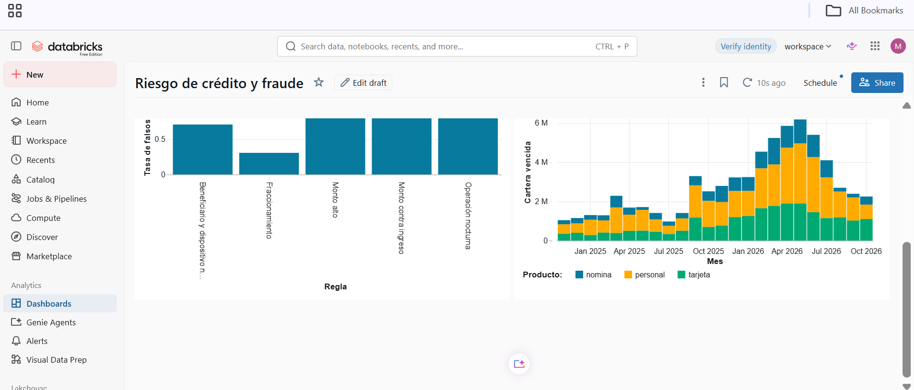
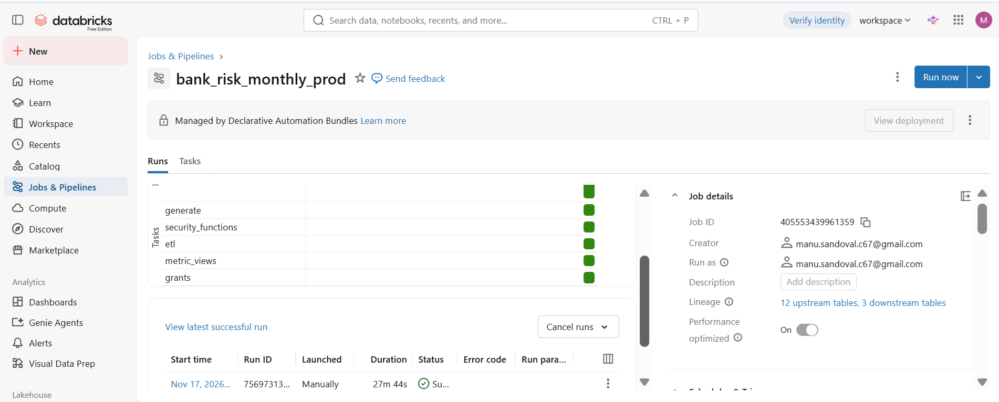

# bank-risk-genie

Credit risk and fraud/AML analytics for a fictional Mexican bank on Databricks Free Edition. The data goes through a medallion pipeline into a star schema, three Unity Catalog metric views define the KPIs, and a Genie Agent answers questions on top of them. Personal data is masked and AML alerts are restricted with Unity Catalog, and Genie's accuracy was measured with benchmarks and with repeated runs through the Conversation API.



## Results

- Genie went from 50% to 100% on a 10-question benchmark. Four automated runs through the Conversation API averaged 95% (80 to 100).
- Name, RFC, CURP and CLABE are masked for anyone outside `risk_team`, and AML alerts (PLD) are only visible to that group. Genie and the published dashboard apply the same rules per user.
- IMOR (non-performing loan ratio), past-due portfolio, fraud rate, false-positive rate and median handling time are defined once in the metric views and reused by Genie, the dashboard and SQL.
- Each push to `main` runs the tests and deploys the prod pipeline and job with a Databricks Asset Bundle.

## How it works

```
generator -> volume (CSV) -> bronze -> silver -> gold -> metric views -> Genie / dashboard
```

- bronze: Auto Loader streaming tables
- silver: typed columns and data quality expectations
- gold: star schema with column masks and a row filter
- metric views: `mv_credit_risk`, `mv_fraud`, `mv_alerts`

The prod job runs the generator and the masking functions in parallel, then the pipeline, the metric views and the grants.



## Data

Synthetic, with a fixed seed, so dev and prod have the same numbers.

| Table | Rows | Content |
|---|---|---|
| customers | 5,000 | segment,